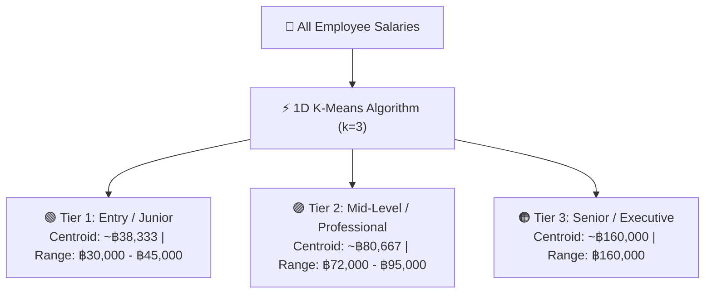

# Std6730202564IPFinal2026 — HR Manager & Salary Analytics System

**Internet Programming Final Examination 2026**  
**Student ID:** Std6730202564  
**Project Topic:** HR Manager & Salary Analytics System  
**Backend:** Node.js + Express.js + MySQL (with In-Memory Fallback)  
**Database:** MySQL (`ip_std6730202564`) with tables `AisKhun_employees` and `AisKhun_users`  
**Frontend:** React Native + Expo (Cross-Platform Mobile & Web)  
**Data Mining Algorithm:** 1D K-Means Salary Clustering  

---

## 🏗️ Project Architecture

```
Std6730202564IPFinal2026/
├── backend/
│   ├── .env.example          # Environment variables template
│   ├── .gitignore            # Backend gitignore (.env, node_modules)
│   ├── package.json          # Backend dependencies & npm scripts
│   ├── server.js             # Express.js REST API server (Port 3000)
│   ├── config/
│   │   └── database.js       # MySQL pool (mysql2/promise) & table init
│   ├── routes/
│   │   ├── auth.js           # Authentication route (POST /api/login)
│   │   ├── employees.js      # CRUD & Phase 2 salary-clusters (AisKhun_employees)
│   │   └── analytics.js      # Salary Analytics & K-Means endpoints
│   ├── data/
│   │   └── employees.js      # In-memory employee fallback store
│   ├── middleware/
│   │   └── auth.js           # Token authentication middleware
│   ├── utils/
│   │   └── kmeans.js         # 1D K-Means clustering algorithm
│   ├── sql/
│   │   └── schema.sql        # Database table definitions (AisKhun_ prefix)
│   ├── scripts/
│   │   ├── seed-admin.js     # Seeds admin user into AisKhun_users
│   │   └── seed-employees.js # Seeds employees into AisKhun_employees
│   ├── test-api.js           # Automated test suite (33 tests)
│   └── README.md             # Backend documentation & MySQL specification
├── frontend/
│   ├── package.json          # Frontend dependencies (Expo & React Native)
│   ├── app.json              # Expo configuration
│   ├── App.js                # Root application component & auth state
│   ├── src/
│   │   ├── api/
│   │   │   └── api.js        # Universal REST API client
│   │   ├── screens/
│   │   │   ├── LoginScreen.js      # Admin login with credential autofill
│   │   │   └── DashboardScreen.js  # Staff management & K-Means analytics dashboard
│   │   └── components/
│   │       ├── EmployeeCard.js     # Employee item with status toggle & delete
│   │       └── SalaryClusterCard.js# K-Means salary tier card with progress bar
│   └── README.md             # Frontend documentation
├── .gitignore
└── README.md                 # Main project documentation
```

---

## 🗄️ Database Tables (`AisKhun_` prefix)

In database `ip_std6730202564`:
1. **`AisKhun_employees`**:
   - `id`: INT UNSIGNED AUTO_INCREMENT PRIMARY KEY
   - `name`: VARCHAR(150) NOT NULL
   - `position`: VARCHAR(150) NOT NULL
   - `status`: ENUM('Active', 'On Leave') NOT NULL DEFAULT 'Active'
   - `salary`: DECIMAL(12,2) NOT NULL
   - `created_at`: TIMESTAMP DEFAULT CURRENT_TIMESTAMP
   - `updated_at`: TIMESTAMP DEFAULT CURRENT_TIMESTAMP ON UPDATE CURRENT_TIMESTAMP
   - INDEX on `status`

2. **`AisKhun_users`**:
   - `id`: INT UNSIGNED AUTO_INCREMENT PRIMARY KEY
   - `username`: VARCHAR(100) NOT NULL UNIQUE
   - `password_hash`: VARCHAR(255) NOT NULL (Bcrypt)
   - `created_at`: TIMESTAMP DEFAULT CURRENT_TIMESTAMP

---

## 🚀 How to Run the Project

### 1. Start the Backend API Server

```bash
cd backend
npm install
npm start
```
*Backend runs on `http://localhost:3000`.*

To run tests:
```bash
npm run test:backend
```

### 2. Start the Frontend App (Expo)

```bash
cd frontend
npm install
npm start
```
- Press **`w`** for Web Browser (`http://localhost:8081`).
- Press **`a`** for Android Emulator.
- Press **`i`** for iOS Simulator.

---

## Authentication Setup

Set `ADMIN_PASSWORD` and `AUTH_TOKEN` in `backend/.env` before starting the API. The admin account is created only when `ADMIN_PASSWORD` is configured.

---

## 📊 K-Means Salary Clustering Analytics (Phase 2)

Algorithm: **1D K-Means Clustering ($k=3$)**

When running the application, the web frontend interacts directly with `GET /api/analytics/salary-clusters` to visualize salary tiers dynamically:



### Salary Cluster Summary Table

| Tier | Category | Centroid (Avg) | Salary Range | Distribution |
|---|---|---|---|---|
| **Tier 1** | Entry / Junior | ฿38,333 | ฿30,000 - ฿45,000 | 42.9% |
| **Tier 2** | Mid-Level / Professional | ฿80,667 | ฿72,000 - ฿95,000 | 42.9% |
| **Tier 3** | Senior / Executive | ฿160,000 | ฿160,000 | 14.2% |
